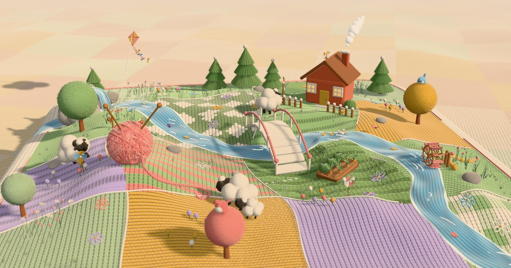

# Yarn World

A knitted diorama built with three.js. Pull the thread on the yarn ball to knit the world; pull the loose end at the cushion edge to unravel it back into the ball.

**Live:** [yarn.krisyang.dev](https://yarn.krisyang.dev)



Everything on the island can be poked or dragged: pick up the sheep, spin the pinwheels, knock on the house door, flip the kite.

## Run

```bash
npm install
npm run dev
```

Add `?debug=1` to the URL for an fps counter.

## Credits

Sound effects are CC0 recordings from [freesound.org](https://freesound.org), listed in [public/sfx/SOURCES.txt](public/sfx/SOURCES.txt).

## License

Code is MIT. Sound files are CC0.
